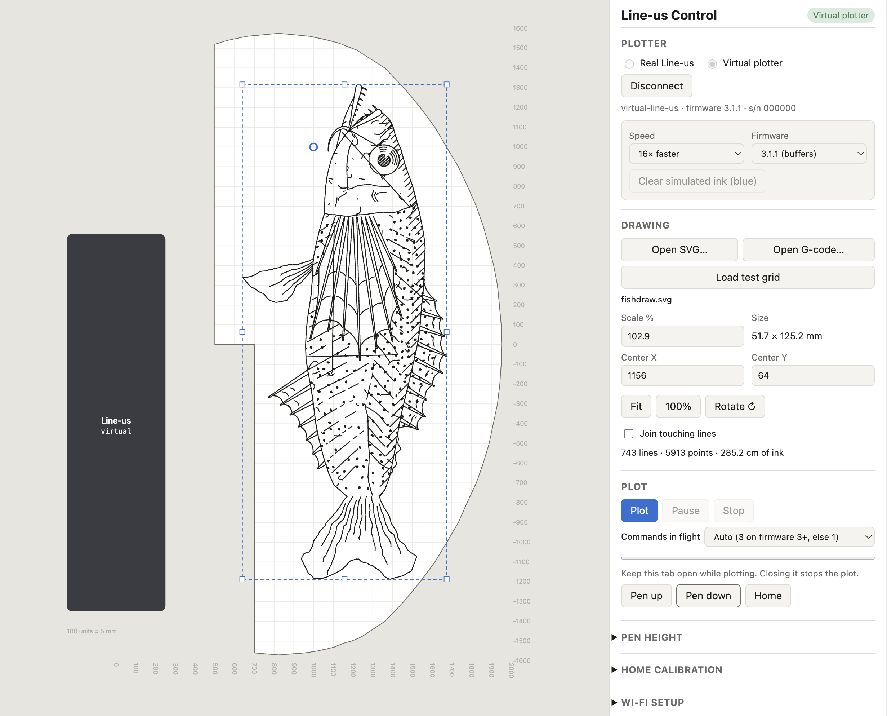

# Line-us Control

A simple app for drawing SVG and G-code files with a [Line-us](https://www.line-us.com) pen plotter. It runs in your web browser with no installations. With this app you can:

- **Plot an SVG or G-code drawing** made of lines and curves, and position and size it on the page.
- **Load and plot a test grid** to check the plotter's reach and calibration.
- **Calibrate** the plotter's pen height and home position.
- **Set up the plotter's Wi-Fi** and rename it.
- **Practice with a virtual plotter** when the real one isn't nearby.

### Contents: 

* Getting started
* Plotting a drawing
* Setting the pen height
* Setting the home position
* Setting up Wi-Fi
* The virtual plotter
* The log
* Troubleshooting
* Credits

---

## Getting started

1. Turn on the Line-us and wait for its light to glow solid blue (connected to Wi-Fi). Make sure your computer is on the same network.
2. Double-click **`index.html`** to open it in Chrome, Safari or Firefox.
3. Under **Plotter**, leave the address as `line-us.local` (or type your plotter's name or IP address) and press **Connect**.

If the light never turns solid blue, the plotter isn't on your Wi-Fi yet — see **Setting up Wi-Fi** below. To find your way around without a real device, choose **Virtual plotter** instead and press **Connect**.

## Plotting a drawing

1. Press **Open SVG…** or **Open G-code…**, or drag a file onto the page. (Or press **Load test grid** for a built-in calibration grid — see below.)
2. Your drawing appears on the D-shaped map of the area the plotter can reach. The robot sits on the left and the small circle marks its home position.
   - **Drag** inside the drawing's dashed box to move it. **Drag a corner or edge handle** (the small squares), or **scroll** inside the box, to make it bigger or smaller. It always keeps its proportions.
   - Or type an exact **Scale** and **Center** position, or use **Fit**, **100%** (true size) and **Rotate**.
   - Anything drawn in **red** is out of the arm's reach and will be skipped.
   - Tick **Join touching lines** to draw lines whose ends meet as one continuous stroke. This saves lifting and lowering the pen at every join, which can noticeably speed up drawings exported as many short pieces. Lines are otherwise drawn in the order they appear in the SVG.
3. Press **Plot**. A dot on the map follows the pen. Use **Pause** (the pen lifts) and **Stop** (the pen lifts and goes home) if needed.

**Keep the page open while plotting.** Closing the tab, or letting your computer go to sleep, will stop the drawing.

**About SVG files:** the app draws strokes (lines, polylines, rectangles, circles, ellipses, arcs and Bézier curves), not fills or hatching. Text and cloned objects are ignored, so convert text to paths and unlink clones in your drawing program first. An SVG saved with real-world units (such as millimetres) opens at its true size.

**About G-code files:** the app reads ordinary plotter G-code (for example from vpype or other plotter software) and treats it like any other drawing, so you can move and resize it. It works out pen up and down by itself. G-code written for the Line-us itself (machine units, Z0 for pen down and Z1000 for pen up) opens at its exact position on the plotter.

**The test grid:** **Load test grid** drops a 1 cm grid that fills the plotter's reachable area, with one of its crossings exactly on the home point. It's useful for checking the arm's reach, pen height and home calibration, and for seeing how the plotter draws. Unlike other drawings it has a fixed position and size, so it can't be moved, resized or rotated; just press **Plot**.

**Pen pressure (G-code only):** if a G-code file uses varying Z heights while drawing, the app turns them into pen pressure. This is ideal for a squishy brush pen.
- **Pen up:** the file's highest Z lifts the pen.
- **Pressure:** lower values press harder, blending smoothly along each line.
- **Settings:** a **Pen pressure** box appears with three plotter heights. The plotter's heights run from 1000 (pen fully up) to 0 (pressing as hard as it can), and the pen just touches the paper at about 400; the **Seat pen** step sets that up.
  - **Pen up (travel):** the height for moving between lines. The default is 1000. A lower value, such as 600, makes lifts quicker, as long as the pen still clears the paper.
  - **Lightest stroke:** the height for the file's lightest drawing values. The default is 400, just touching. If faint parts of a drawing don't show, lower it.
  - **Heaviest stroke:** the height for the file's heaviest drawing values. The default is 0. If the brush squashes too much, raise it.
  - Next to each box is the file value it replaces. Pen up must be higher than both stroke heights.
- **Preview:** the line thickness shows the pressure.

SVG drawings are always simply pen up or pen down.

**Commands in flight:** leave this on **Auto**, which lets the plotter draw smoothly without pausing at every corner. If a plot behaves strangely, try **1**.

## Setting the pen height

Open the **Pen height** section and follow the steps shown there:

1. Press **Read**, then **Seat pen**. Loosen the pen, let it rest on the paper, tighten it, and press **Raise**.
2. For each corner, press **Start**. The pen slowly lowers while drawing a short dash. Press **Stop** as soon as you see ink.
3. Press **Save** to store the four heights on the plotter.

## Setting the home position

Open **Home calibration**. Press **Go home**, use the arrow buttons to nudge the pen until it sits exactly over the small hole in the base plate, then press **Save home**.

## Setting up Wi-Fi

Telling the plotter which network to join can't be done from the page — the plotter only accepts Wi-Fi settings over a direct connection that a browser can't make — so the **Wi-Fi setup** section walks you through constructing and executing a one-time terminal command. Open it and follow the numbered steps:

1. Hold the plotter's button for about 2 seconds until its light flashes red.
2. Join the **Line-us-Setup** Wi-Fi network from your computer.
3. Type your network name and password into the two boxes. The section builds the exact command for you.
4. Open the Terminal app, copy the connect command (`nc 192.168.4.1 1337`) and run it; wait for the `hello…` line.
5. Copy the `M587 …` line it built and paste that in. Solid blue light means it joined; flashing red means the password was wrong.

On Windows, use **PuTTY** in "Raw" mode instead of the Terminal command. The section has the details.

Line-us can only join **2.4 GHz** networks with **WPA2-Personal** (password-only) security, such as a home Wi-Fi or a phone hotspot. Networks that ask for a username as well as a password, such as Eduroam, won't work. Everything you type stays on your computer.

The **Machine** section renames the plotter and shows machine information. After renaming, restart the plotter and connect using the new name followed by `.local` (for example `studio-plotter.local`).

## The virtual plotter

To try things out without a real Line-us, choose **Virtual plotter** and press **Connect**. It behaves like the real machine:

- It responds to the same commands and takes a realistic amount of time to draw.
- It shows its "ink" in blue on the map.
- Its paper is slightly uneven, so you can rehearse the pen-height steps. Press **Stop** when blue ink appears.

You can speed it up (4×, 16× or instant) and clear its ink at any time.

## The log

The **Log** at the bottom shows every message exchanged with the plotter. Advanced users can type raw G-code commands there, such as `M114` to ask for the pen's position.

## Troubleshooting

- **Can't connect:** check that the plotter's light is solid blue and that you're on the same Wi-Fi. Try its IP address instead of `line-us.local`. On Windows, `.local` names need an up-to-date Windows 10 or 11.
- **Still can't connect:** some setups don't allow a page opened directly from a file. In Terminal, go to this folder and run `python3 -m http.server`, then open <http://localhost:8000/>.
- **Plots are jerky or unreliable:** set **Commands in flight** to **1**.
- **Part of the drawing is red:** it's outside the arm's reach. Move or shrink it until it's all black.

## Credits

This app was built by Golan Levin with Claude Code. The plotter's command language was learned by decompiling the official Line-us app with [JPEXS Free Flash Decompiler](https://github.com/jindrapetrik/jpexs-decompiler). Several important details came from Brian Boucheron's ([@beardicus](https://github.com/beardicus)) open-source [line-us](https://github.com/beardicus/line-us) JavaScript library (MIT license). From it, we learned that the plotter accepts WebSocket connections, that newer firmware can queue several commands for smoother drawing, and that the pen lowers at the end of a move rather than the start. Line-us itself is made by the team at [line-us.com](https://www.line-us.com). More technical detail, and the story of how the app was made, is in [`additional_information.md`](doc/additional_information.md).

<!-- claude --resume 98ee1341-1ce0-451c-9321-17d3722e93aa -->